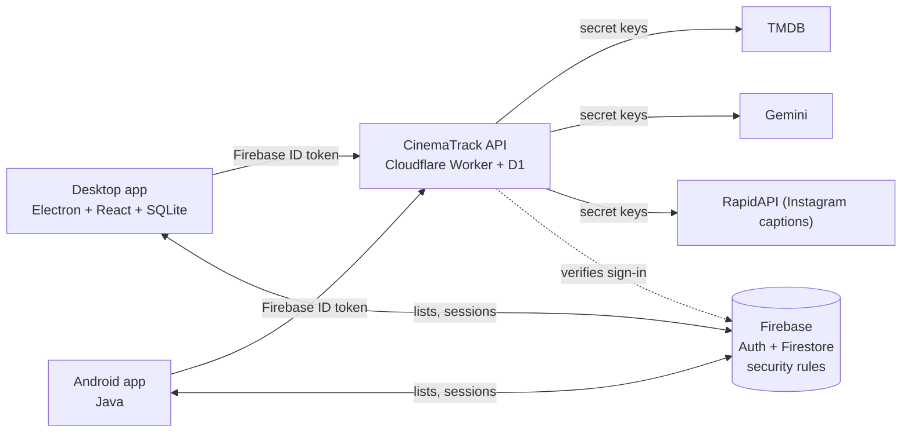

# CinemaTrack 🎬

**Track the movies and series you watch, on your PC and your phone, and let an AI help you pick what to watch next, alone or together with a friend.**

CinemaTrack is open source (MIT). It is two apps (a Windows desktop app and an Android app) that share one account, plus a small
API that keeps every third-party key out of the apps. It has two modes in one: **CinemaTrack** for movies and **DiziTrack** for series.

> Built for [Hillpost Hacktober 2026](https://www.hillpost.dev/hacktober). Early versions went to real testers, and what they found
> shaped the releases: see [How it grew](#how-it-grew).

## What it does

- **Watchlist and watched log.** Search TMDB, add titles, mark them watched with a rating and a note. Filter and sort your list (on the phone: by title, rating, year or the date you added them).
- **Statistics.** Totals, average rating, favourite genre and a GitHub-style heatmap calendar of what you watched.
- **AI chat.** Gemini knows your list and your history, so "something short and funny for tonight" gets an answer that fits *you*.
- **Watch Together.** Two people join a session with a 6-letter code, each says what they feel like (or "surprise me"), and the AI picks something both will enjoy, drawing on both lists.
- **Share from Instagram (Android).** Share a reel to CinemaTrack and it finds the movie or series from the caption.
- **Same list everywhere.** Add a title on the PC and it appears on the phone in seconds. English and Turkish throughout.
- **Your data is yours.** Lists and notes are private to your account, you can rename yourself, and you can **delete your account** and everything stored online from inside both apps.

## How it works



| Folder | What | Stack |
|---|---|---|
| [`desktop/`](desktop) | Windows app. Keeps a local SQLite copy and syncs it to the cloud | Electron 44, React, TypeScript, `node:sqlite`, Vitest |
| [`mobile/`](mobile) | Android app | Java, Firebase, Gradle |
| [`worker/`](worker) | The CinemaTrack API: the **only** place that holds the TMDB, Gemini and RapidAPI keys | Cloudflare Workers, D1, TypeScript |
| [`firebase/`](firebase) | Firestore security rules shared by both apps, with tests | Firebase emulator |

A few decisions worth knowing:

- **No keys in the apps.** A project that anyone can install and read must not ship its API keys, and asking every user to
  create their own TMDB and Gemini account is no way to make an app. So the apps sign in with Firebase and call the Worker,
  which verifies the token, **builds every AI prompt itself** (apps send data, never a prompt, so the shared key cannot be used as a
  free chatbot), allows only a few TMDB endpoints and **limits usage per account and in total**. It also has a kill switch.
  Details: [`worker/README.md`](worker/README.md).
- **Real accounts.** Email and password with a **verified email**, enforced both by the Worker and by the Firestore rules.
- **Security rules you can read.** [`firebase/firestore.rules`](firebase/firestore.rules) is the whole access policy: your lists are
  readable by you only, Watch Together shares a short-lived summary (titles, genres, ratings, never notes) between the two people in a
  session, and everything else is denied. The rules are tested in the Firebase emulator.
- **One computer, many accounts.** The desktop database remembers which account it belongs to. Signing in as someone else starts a
  clean database (the old file is kept as a backup) instead of mixing lists.
- **Honest about limits.** The display-name filter is a courtesy filter, not a security boundary; the AI and Instagram features have daily
  limits (the Instagram lookup uses a 100-requests-a-month plan and caches captions to stay inside it).

## Try it

Download the latest installer and APK from the [**Releases**](../../releases) page.

- **Windows:** run `CinemaTrack-Setup-<version>.exe`. The app is not code-signed yet (that costs money), so Windows shows *"protected your PC"*: **More info → Run anyway**.
- **Android:** open `CinemaTrack-<version>.apk` on your phone and allow installing from that source.
- Each release lists `SHA256SUMS.txt`, so you can check the files: `sha256sum -c SHA256SUMS.txt`.
- Create an account with a real email address (we send a confirmation link) and you are in. Step by step, in English and Turkish: [tester guide](docs/tester-guide.md).

## Run it from source

You do **not** need a TMDB, Gemini or RapidAPI key: the apps talk to the official backend by default.

```bash
# Desktop (Node 22)
cd desktop && npm install && npm run dev

# Android (JDK 17 + Android SDK, or Android Studio)
cd mobile && cp local.properties.example local.properties   # set sdk.dir
./gradlew :app:assembleDebug

# API (Node 22.13+): tests need no account and no network
cd worker && npm install && npm test

# Firestore rules (Java 21+): starts the emulator
cd firebase && npm install && npm test
```

Want your own backend? Create a Firebase project, deploy the rules, deploy the Worker with your own keys
(`wrangler secret put`), and point the apps at them: [`firebase/README.md`](firebase/README.md), [`worker/README.md`](worker/README.md).

## Quality

- **Tests:** the Worker (limits, auth, prompts, the name filter) and the Firestore rules are fully tested, and the desktop database layer has unit tests.
- **CI** on every push and pull request: desktop typecheck, tests and build; Worker typecheck and tests; Firestore rules in the emulator; Android `assembleDebug`.
- **Dependencies:** the shipped desktop app has no known vulnerabilities (`npm audit --omit=dev` reports 0) and the installer contains no native modules.
  What is left in Dependabot, and why, is written down in [SECURITY.md](SECURITY.md).

## How it grew

The first versions went to a small group of testers, and every release answers something they found:

| Release | What the testers found | What changed |
|---|---|---|
| [0.2.0](docs/releases/v0.2.0.md) | Signing in with a second account on one computer showed the first account's lists | Local data now belongs to one account, with tests |
| [0.2.1](docs/releases/v0.2.1.md) | The sort menu was unreadable in the phone's dark theme ([#34](../../issues/34)), no way to sort by date added ([#35](../../issues/35)), *Sign out* in an odd place ([#36](../../issues/36)), no way to rename or filter names ([#37](../../issues/37)) | Readable menu, the date added kept in the cloud, a settings gear, renaming and a name filter |
| [0.2.2](docs/releases/v0.2.2.md) | Some profane names got through; Turkish letters were refused in names | A much wider word list (it lives on the server, so it updates without an app release), Turkish letters accepted |

The full history is in the [changelog](CHANGELOG.md).

## Contributing

Small contributions are welcome: a typo, a translation, a test, a bug fix, an idea. Start with the
[`good first issue`](../../labels/good%20first%20issue) label and read [CONTRIBUTING.md](CONTRIBUTING.md).
Found a security problem? Please follow [SECURITY.md](SECURITY.md) instead of opening a public issue.

## Credits and license

[MIT](LICENSE). Movie and series data, posters and streaming providers come from **TMDB**, and AI answers from **Google Gemini**.
Instagram captions are looked up through a RapidAPI service.

This product uses the TMDB API but is not endorsed or certified by TMDB.
